<div align="center">


# ESP32-S3 Security Camera

**Turn an ESP32-S3-CAM board into a self-hosted security camera with motion recording,
face recognition, a polished web app and secure remote access — no cloud, no app store,
no port forwarding.**


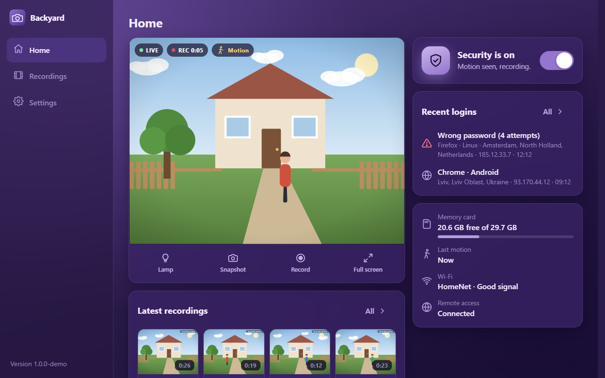

</div>

---

## ✨ Highlights

- 📹 **Live view** — MJPEG stream that reconnects by itself when it stalls, snapshot, flash lamp with brightness (on boards that have one), full screen, one-tap manual recording.
- 🛡️ **Security mode** — motion detection records AVI clips to the microSD card, including a few seconds *before* the motion. Long clips are split automatically.
- 🙂 **Face recognition** — names known people over the live picture, marks everyone else as a stranger, and keeps a "who was seen" log with photos. Up to 16 face photos are remembered on the camera itself (Espressif esp-dl models, nothing leaves the device).
- 🎞️ **Recordings browser** — grouped by day, filter by motion / manual, in-browser player with seeking, speed and download as **MP4** that plays on any phone (converted in the browser). Delete one, a day, or everything.
- ♻️ **Never runs out of space** — the oldest recordings are removed when the card fills up (keeps 5 % of the card, at least 100 MB, free).
- 📶 **Zero-config setup** — the camera opens its own Wi-Fi `ESP32-Camera-XXXX`; the setup wizard pops up on most phones and walks you through Wi-Fi and login.
- 🌍 **Remote access** — through your own tiny relay server over TLS. Nothing to open on your home router.
- 🔐 **Secure by default** — salted PBKDF2 passwords, hashed session tokens, lockout per address (strangers can't lock you out), the password asked again for risky changes, live video that stops on logout, protection against DNS rebinding, and a hardened relay that only serves signed camera pages.
- 🎛️ **Full sensor control** — resolution, quality, brightness/contrast/saturation, mirror/flip/rotate, plus the sensor controls (white balance, exposure, gain, pixel/lens correction). OV2640 and OV3660 (up to 2048×1536) are detected automatically.
- 🎨 **Six colour schemes** — purple, emerald, ocean, amber, graphite and light, stored on the camera.
- 🌐 **English & Ukrainian** — switchable per browser.
- ⬆️ **OTA updates** — flash new firmware straight from the browser (after typing the password again).

## 📸 Screenshots

<table>
  <tr>
    <td width="50%">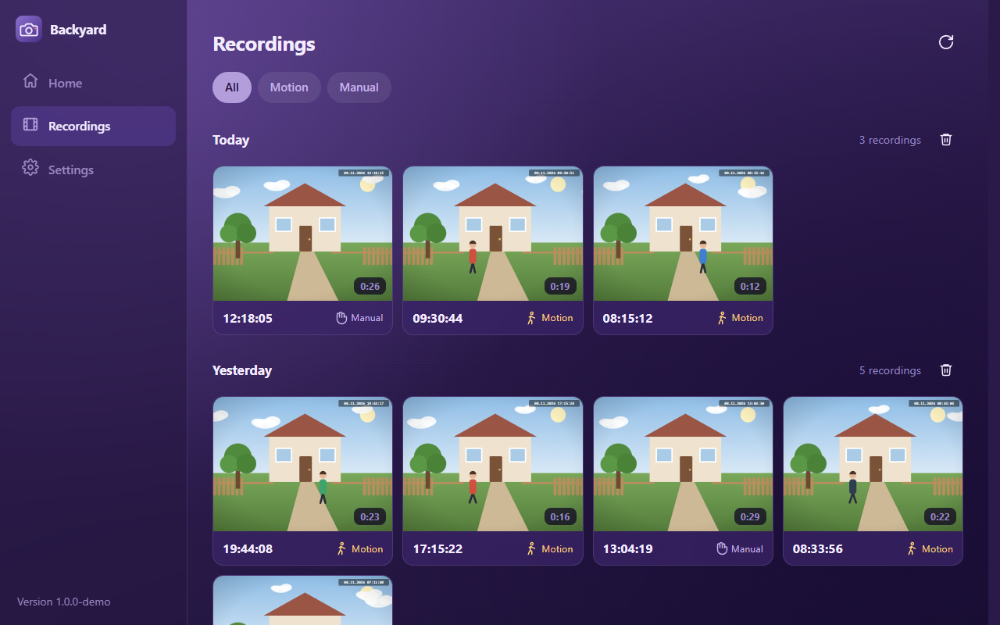<p align="center"><sub><b>Recordings</b> — grouped by day, filter by motion or manual</sub></p></td>
    <td width="50%">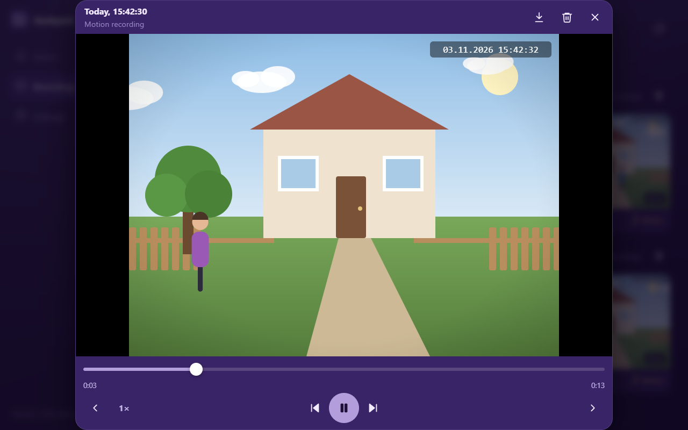<p align="center"><sub><b>Player</b> — seek, change speed, download, delete</sub></p></td>
  </tr>
  <tr>
    <td>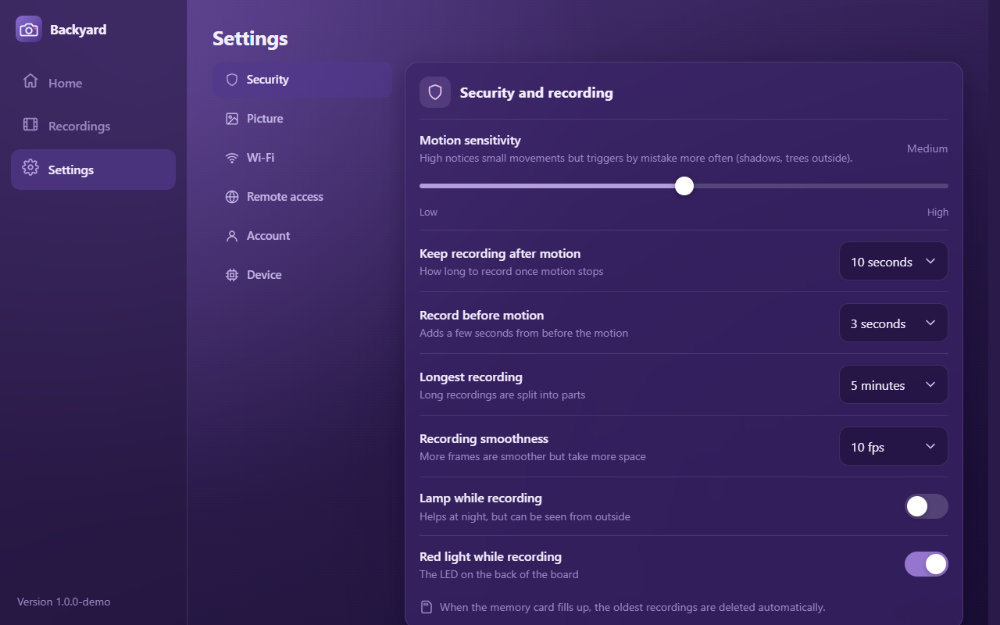<p align="center"><sub><b>Security</b> — motion sensitivity and timings</sub></p></td>
    <td>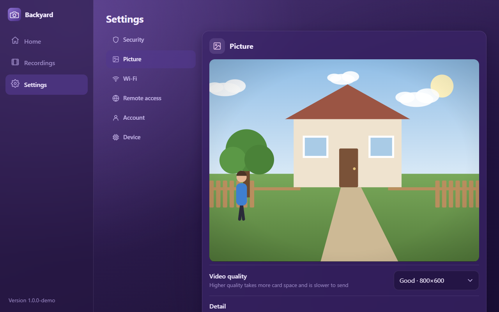<p align="center"><sub><b>Picture</b> — tune the sensor with a live preview</sub></p></td>
  </tr>
  <tr>
    <td>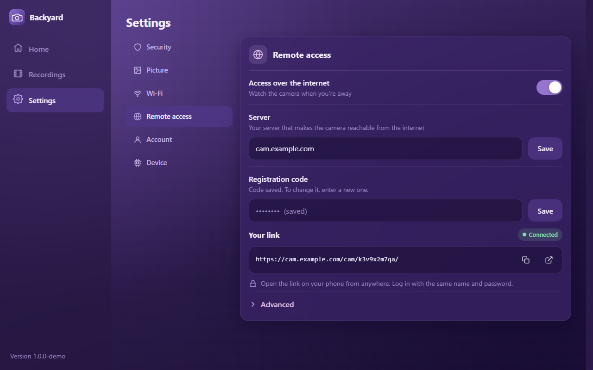<p align="center"><sub><b>Remote access</b> — your private link</sub></p></td>
    <td>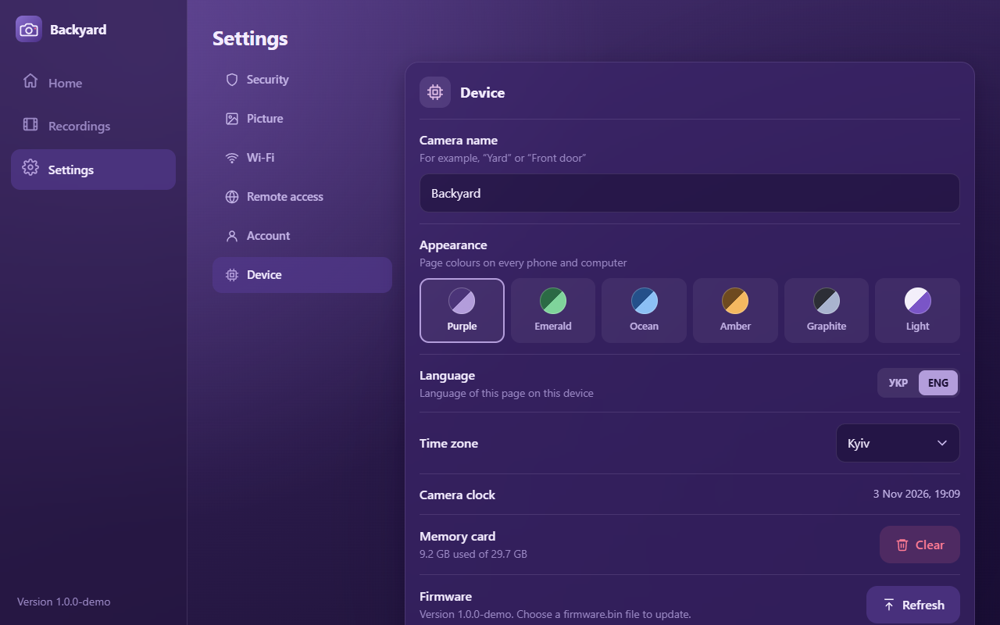<p align="center"><sub><b>Device</b> — name, time zone, theme, firmware update</sub></p></td>
  </tr>
  <tr>
    <td colspan="2">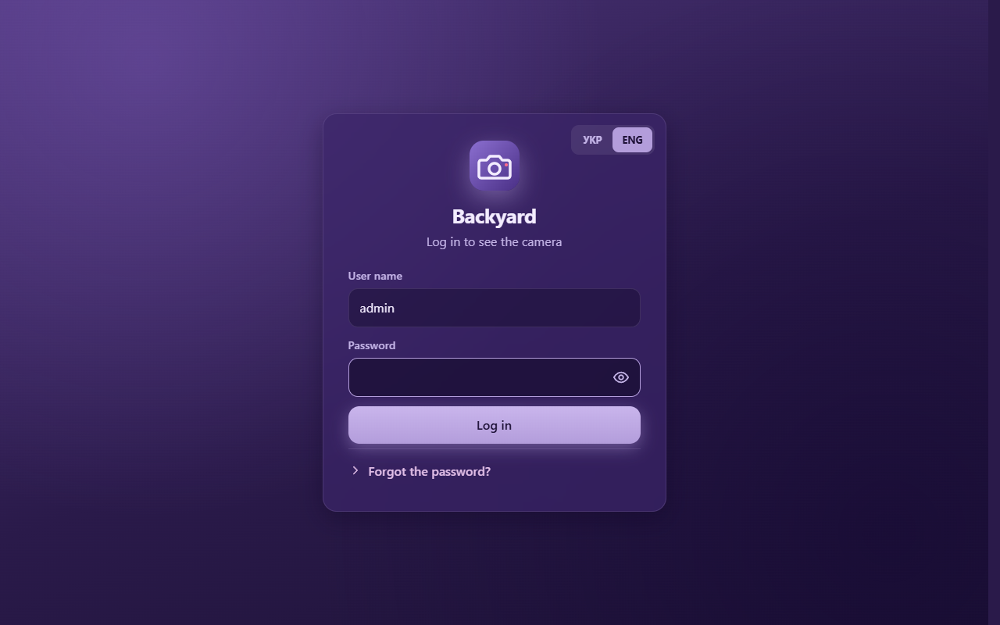<p align="center"><sub><b>Login</b></sub></p></td>
  </tr>
</table>

### On the phone

<table>
  <tr>
    <td>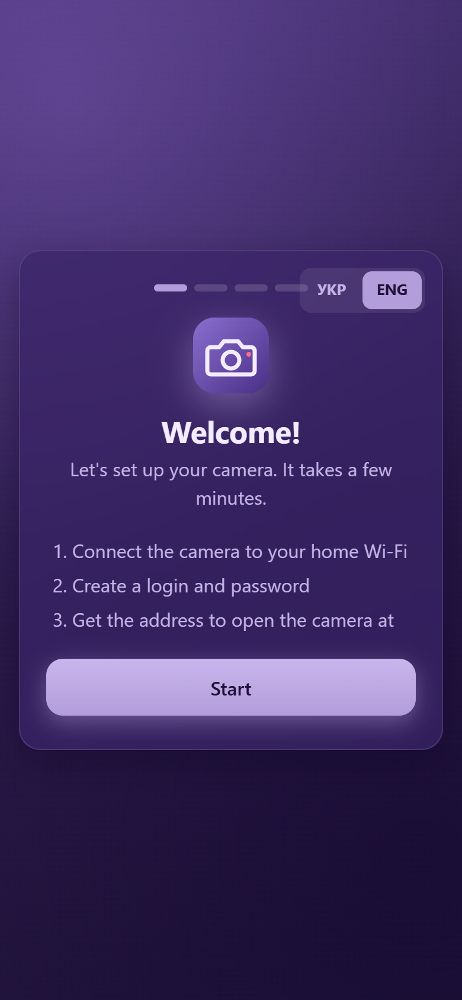</td>
    <td>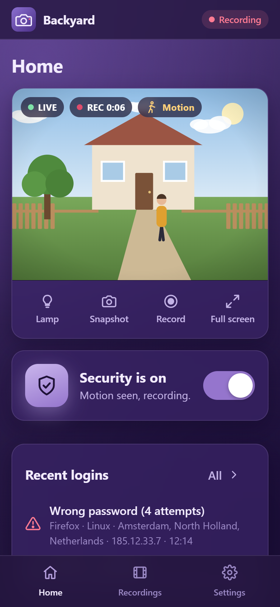</td>
    <td>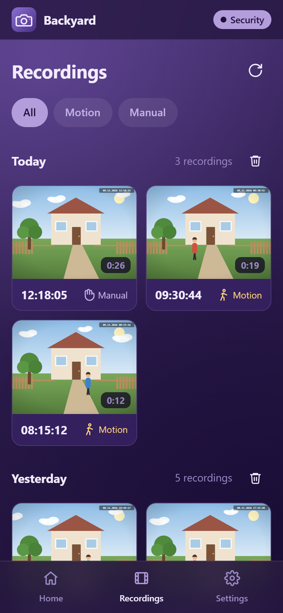</td>
  </tr>
  <tr>
    <td align="center"><sub>Setup wizard</sub></td>
    <td align="center"><sub>Live view</sub></td>
    <td align="center"><sub>Recordings</sub></td>
  </tr>
</table>

### Colour schemes

<table>
  <tr>
    <td>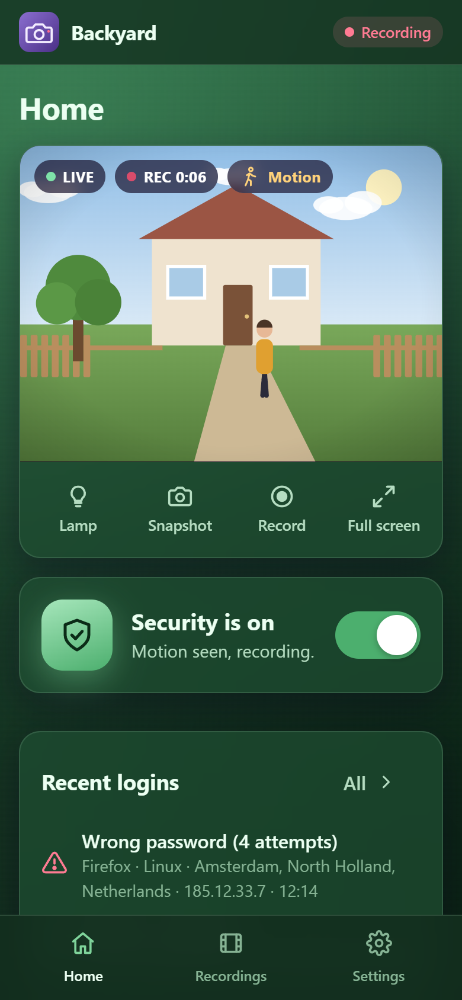</td>
    <td>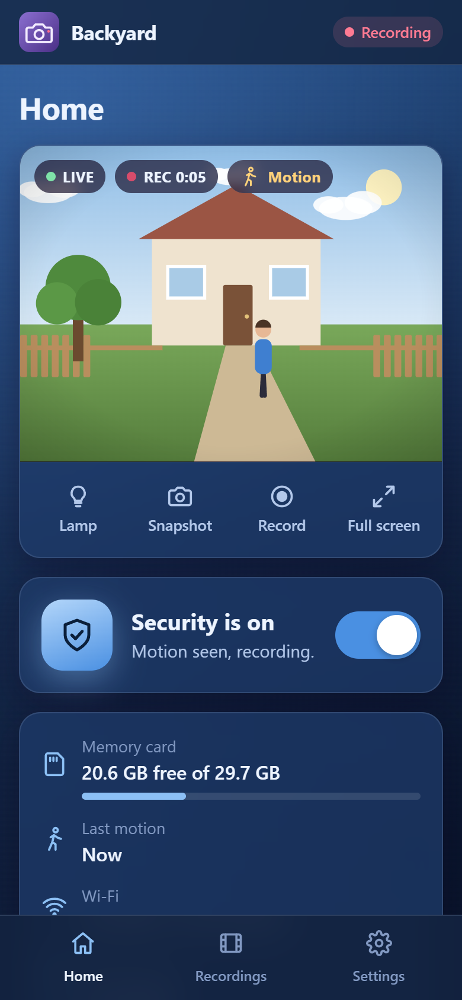</td>
    <td>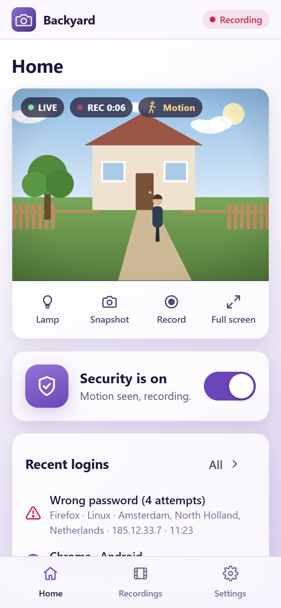</td>
  </tr>
  <tr>
    <td align="center"><sub>Emerald</sub></td>
    <td align="center"><sub>Ocean</sub></td>
    <td align="center"><sub>Light</sub></td>
  </tr>
</table>

> 📄 **User guide (PDF):** [English](docs/Setup-Guide.pdf) · [Українською](docs/Інструкція-з-налаштування.pdf) — setup, everyday use and troubleshooting, with screenshots, for non-technical users.

> 💡 **Try it without hardware:** `python scripts/build_demo.py` builds a single-file demo — see [Demo](#-demo-without-the-board).

## 🧰 Hardware

| Part | Notes |
| --- | --- |
| **ESP32-S3-CAM N16R8 (HW-679)** | ESP32-S3, 16 MB flash, 8 MB PSRAM; use an **OV2640** or **OV3660** camera (the RHYX M21-45 it often ships with can't make JPEG) |
| USB-TTL adapter (CP2102, CH340…) | first flash only, see below |
| microSD card | up to 32 GB, FAT32 |
| 5 V power supply | a stable one — Wi-Fi and the camera draw spikes |

> The classic **AI-Thinker ESP32-CAM** (OV2640, 4 MB flash) still builds and runs (`-e esp32cam`,
> first flash with the ESP32-CAM-MB USB board), but without face recognition, and with less
> memory to spare for remote access. It does have a switchable flash lamp, which the HW-679 lacks.

### Notes on the HW-679 board

- **Flashing:** connect only adapter TX→RX, RX→TX and GND, and power the board from its own 5 V
  supply (fed from the adapter's 5 V pin it browns out as soon as Wi-Fi starts). The adapter has no
  auto-reset, so hold **BOOT**, tap **RST**, release BOOT, flash, then tap RST. If the serial log shows
  `boot:0x0 (DOWNLOAD…)` after a normal reset, something is holding GPIO0 low.
- **Pins:** camera and microSD (CLK 39, CMD 38, D0 40) are verified. The small status LED is GPIO2.
  The white flash LED on our board is not wired to any GPIO (every free pin was tested), so there
  is no lamp button on this board.
- **Mounting:** if the camera hangs upside down, turn on *Flip* and *Mirror* (see [Recovery](#-recovery)),
  or faces won't be detected.

## 🚀 Quick start

### 1. Build & flash

Requires [PlatformIO](https://platformio.org/).

```bash
pio run                    # build (also gzips web/ into src/web_assets.h)
pio run -t upload          # flash over the USB-TTL adapter (BOOT + RST, see above)
pio device monitor         # serial log, 115200 baud
```

The partition table (`partitions_16mb.csv`) has a `faces` partition for remembered faces, so
the first flash must be over USB; browser updates keep the partition table they find. Pin maps
are in `src/board.h`. For the classic ESP32-CAM add `-e esp32cam` (e.g. `pio run -e esp32cam -t upload`).

Later updates can be done from the browser: **Settings → Device → Firmware**, choosing
`.pio/build/esp32s3cam/firmware.bin`. The camera asks for the password first (the confirmation
lasts 10 minutes); live video pauses while the file uploads. If you use a relay that checks page
signatures, build with your `UI_SIGN_KEY` set (step 3), or the remote link shows "Unknown firmware"
for that build (at home it works either way).

**Releases:** set `FW_VERSION` in `platformio.ini`, commit, then push a matching tag
(`git tag v1.0.1 && git push origin v1.0.1`). GitHub Actions builds both boards and publishes
a release with `*-update.bin` (for the browser update) and `*-full.bin` (first flash over USB
at address 0x0). Released firmware has no relay baked in; its pages are signed with the
repository secret `UI_SIGN_KEY` (Settings → Secrets and variables → Actions), unsigned without it.

### 2. First setup

1. Power the camera. It opens an open Wi-Fi network named `ESP32-Camera-XXXX`.
2. Connect with your phone — the setup page usually pops up by itself.
3. Pick your home Wi-Fi and create a login.
4. The wizard shows the camera's address: `http://192.168.x.x/` or `http://camera-xxxx.local/`.
5. Write down the password of the camera's own network from **Settings → Wi-Fi**. From now on
   `ESP32-Camera-XXXX` only comes back when the home Wi-Fi is gone, and then it needs that password.

### 3. Optional: preset your relay server

To bake your remote-access server (and its registration code) into the firmware, set these
before building — otherwise enter them in the web UI. `UI_SIGN_KEY` signs the web pages, so a
relay with the same key serves them (see *Security model* below):

```powershell
$env:RELAY_HOST="cam.example.com"; $env:RELAY_TOKEN="..."; $env:UI_SIGN_KEY="..."   # PowerShell
```

```bash
export RELAY_HOST=cam.example.com RELAY_TOKEN=... UI_SIGN_KEY=...                   # bash
```

Release builds (`.github/workflows/release.yml`) take `UI_SIGN_KEY` from the repository secret
of that name.

> 🔒 Keep your own values out of the repository: `local/` is git-ignored and is the place for
> personal build scripts and server-specific config.

## 🆘 Recovery

| Situation | What happens |
| --- | --- |
| **Forgot the password** | Press **RST three times** in a row (about a second apart). For 15 minutes the camera opens `ESP32-Camera-XXXX` without a password; from that network (not from home or the internet) you can set a new login and Wi-Fi. Recordings are kept; remembered faces, other logins and the remote link are reset, since whoever does this may not be the owner. |
| **Home Wi-Fi is down** | After a minute the camera opens `ESP32-Camera-XXXX` so it can still be reached, and closes it once the home network is back. That network has its own password, shown in **Settings → Wi-Fi** (write it down). |
| **Moving to another Wi-Fi** | With the old network still around: **Settings → Wi-Fi**; if the new one fails within 25 s the camera returns to the old one. Somewhere new: wait a minute, join `ESP32-Camera-XXXX`, log in and pick the new network. The remote link stays the same. |
| **Picture upside down** | **Settings → Picture**: turn on both *Flip* and *Mirror* (a 180° turn on the sensor, so recordings and face recognition get it upright too). *Rotation on screen* only turns the picture in the browser. |

## 🌍 Remote access

```
 Browser ──HTTPS──▶  Your server (relay)  ◀──WSS── ESP32-CAM (at home)
           /cam/<id>/...                  outgoing tunnel, no open ports
```

The camera keeps a single outgoing WebSocket to `wss://<server>/cam-relay/ws`. The relay
forwards every browser request for `/cam/<id>/...` down that tunnel and the camera answers
from its own web server. Set the server in **Settings → Remote access**; the camera shows its
link `https://<server>/cam/<id>/`.

<details>
<summary><b>🔐 Security model</b></summary>

- **Own subdomain** (e.g. `cam.example.com`) — camera pages run JavaScript, so they must never
  share an origin with a site that has its own logins.
- **Signed pages** — all cameras share that origin, so a fake camera (one that got the
  registration code out of a real camera's flash) could serve scripts that use another camera's
  login in the same browser. Page files (everything outside `/api/`, `/stream`, `/snapshot`) must
  carry the build's HMAC signature (`UI_SIGN_KEY` at build time and on the relay); everything else
  is sent with `Content-Security-Policy: sandbox`. With `UI_SIGN_ENFORCE=1` unsigned pages are
  refused; without it they are only logged (for switching cameras over).
- **Registration code** — `RELAY_TOKEN` on the server, *Registration code* on the camera (or baked
  in at build time). Strangers can't register cameras; the relay refuses to start without it.
- **Ownership** — the first camera that connects with an id owns it (key stored hashed in
  `data/devices.json`). The id is 10 random characters; *New link* replaces it.
- **Header allowlist both ways** — only the camera's `sid` cookie passes, locked to
  `/cam/<id>/` (`HttpOnly`, `Secure`, `SameSite=Strict`). The relay adds CSP,
  `X-Frame-Options: DENY` and `Referrer-Policy: no-referrer` (the link is the secret, so it must not leak).
- **Password guessing** — 10 password tries per 15 min per address at the relay (login,
  confirmation, password change), plus the camera's own lockout per address: a stranger can't
  lock you out. Many wrong passwords from many addresses stop new addresses for an hour; ones
  that logged in before still may. Passwords need 8+ characters and common ones are refused;
  the camera stores a PBKDF2 hash and only hashes of session tokens. Sessions expire after 30 days.
- **Password again** — firmware updates, Wi-Fi and remote-access changes and deleting every
  recording need the password typed again (good for 10 minutes), so a stolen session alone can't
  make them. Logging out, ending a session or a new password also stops live video within 5 s.
- **Setup** — without a login (first setup, RST×3 recovery) it never works through the relay;
  recovery only from the camera's own Wi-Fi, for 15 minutes after the start.
- **Home network** — the camera answers only to its own names (its address, `camera-xxxx.local`,
  `192.168.4.1`), so a web page can't reach it by pointing its own name at the camera (DNS rebinding).
- **Transport** — TLS from the browser to the server, and from the camera to the server
  (certificate checked against the built-in root list).

`node relay/test/security.js` checks all of the relay part (32 checks).

</details>

<details>
<summary><b>🖥️ Installing the relay on a server</b></summary>

1. **DNS** — point a subdomain (e.g. `cam.example.com`) at the server.
2. **App** — copy `server.js`, `package.json`, `package-lock.json` to `/opt/cam-relay`, run
   `npm ci --omit=dev`, and write `RELAY_TOKEN=<long random code>`, `UI_SIGN_KEY=<the key your
   firmware is built with>` and `UI_SIGN_ENFORCE=1` into `/opt/cam-relay/.env` (`chmod 600`).
3. **Service** — adjust and install `cam-relay.service` into `/etc/systemd/system/`, then
   `systemctl enable --now cam-relay`.
4. **nginx** — adjust and install `nginx-cam.conf` as a site, get a certificate for the subdomain,
   `nginx -t`, `systemctl reload nginx`.

Behind Cloudflare, the relay reads the visitor's address from `CF-Connecting-IP`, but only when
the connection nginx got came from one of Cloudflare's addresses.

Log: `/opt/cam-relay/relay.log`.

</details>

## 🧪 Demo without the board

```bash
python scripts/build_demo.py       # -> dist/camera-demo.html (one file, open it anywhere)
```

The demo runs the real UI, with `demo/demo.js` playing the camera in the browser: a drawn yard
where someone walks past every 30 s (with security on, that becomes a recording), picture
settings applied live, the setup wizard and a fake firmware update. Log in with
`admin` / `demo1234`; the bar on top restarts the wizard or resets the demo. State is kept in the browser.

## 🛠️ Development

UI work without hardware, using a mock camera:

```bash
node dev/mock-camera.js            # http://localhost:8080, login admin / 123456
SETUP=1 node dev/mock-camera.js    # start in the first-setup wizard
```

End-to-end remote access locally: run the relay (`cd relay && npm install && npm start`, without
`UI_SIGN_KEY`: the mock's pages aren't signed), start the mock with `RELAY=ws://127.0.0.1:3040`,
and open `http://127.0.0.1:3040/cam/k3v9x2m7qa/`. The mock asks for the password again like the
camera (Wi-Fi and remote-access changes).

Translations live in `web/i18n.js`, keyed by the Ukrainian source text.

### Memory (read before adding features)

The ESP32-S3's internal RAM is small, and Wi-Fi needs it too: when it runs low, Wi-Fi silently drops
packets and the web servers stall. This Arduino build keeps TLS and every allocation up to 4 KB in
internal RAM, so `src/main.cpp` sends TLS (the relay connection, ~40 KB) and anything from 512 bytes
up to PSRAM. Internal RAM free is the `heap` value in `/api/status`; keep it well above 30 KB with
remote access on and someone watching. Two things must stay internal: task stacks (this build can't
put them in PSRAM) and buffers written to flash (see the firmware update handler). Don't create a
task per request: each finished task left ~565 bytes behind, which is why the stream server on
port 81 runs a fixed pool of workers.

lwIP here has only 16 TCP connections, and every remote request costs the camera two (the tunnel
connects to its own web server). So the camera takes at most 5 tunnel streams (`src/remote.cpp`)
and the relay forwards at most 4 at once, 2 of them live video, queueing the rest
(`relay/server.js`). All remote traffic shares one TLS connection that carries roughly
100–150 KB/s, which is why remote live view asks for 5 fps and the page polls half as often.

The live view reads `/stream` with `fetch` (port 81 answers with CORS for the camera's own page)
and reconnects after 6 s without a frame. iPhones (all WebKit) use a plain `` at home and,
through the relay, fetch one `/snapshot` after another, since there they read only the first frame
of the stream. Cloudflare keeps `.js`/`.css` in browsers for 4 hours whatever the camera says, so
`scripts/embed_web.py` stamps them in `index.html` with `?v=<hash>`. Downloads are converted to MP4 in the browser: WebCodecs
over https (the relay), real-time `MediaRecorder` on the plain-http home network.

### Project layout

| Path | What |
| --- | --- |
| `src/board.h` | pin maps for the supported boards |
| `src/camera.*` | sensor setup, frame hub (one grabber, many readers), flash lamp |
| `src/motion.*` | motion detector: 16×12 brightness grid vs. adaptive background |
| `src/recorder.*`, `src/avi.*` | clip recording (pre-roll ring in PSRAM), AVI writer/reader, crash recovery |
| `src/faces.*` | face detection + recognition on the S3 (esp-dl, JPEGDEC for decoding), remembered faces, sightings log |
| `src/storage.*` | SD card, listing, auto-cleanup |
| `src/netmgr.*` | Wi-Fi, setup AP + captive portal (WPA2 once set up), mDNS, NTP, triple-reset recovery, own-host-name check |
| `src/auth.*` | user, sessions (stored hashed), login history, lockout per address, password confirmation |
| `src/webserver.*` | UI and JSON API on port 80 |
| `src/streamsrv.*` | live video on port 81 (`/stream`, `/snapshot`) |
| `src/remote.*` | tunnel client to the relay |
| `web/` | the UI (plain HTML/CSS/JS, no build step; `scripts/embed_web.py` gzips and signs it into the firmware) |
| `relay/` | relay server for remote access (Node, `ws`); `relay/test/security.js` checks it |
| `dev/mock-camera.js` | fake camera for UI work without hardware (`FACES=1` for the S3 face features) |
| `demo/demo.js` | in-browser camera for the single-file demo |
| `docs/screenshots/` | images used in this README |
